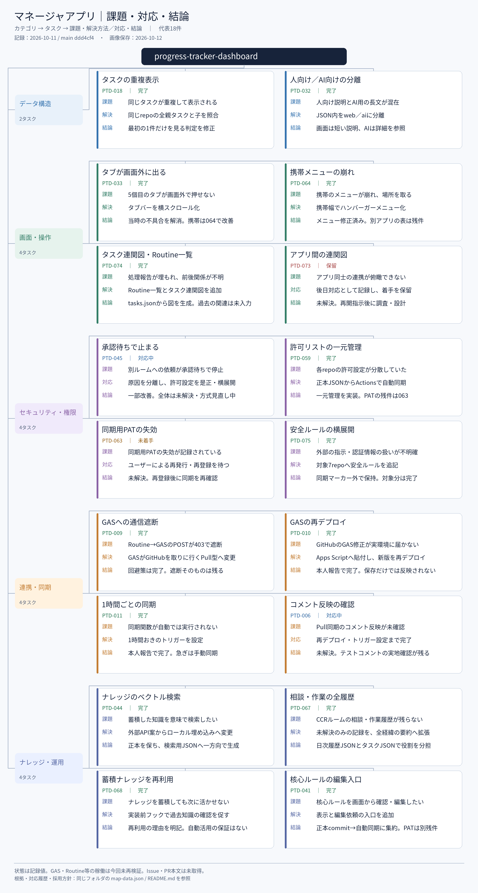

# 課題解決マインドマップ（2026-10-12保存）

会話で作成した、代表18タスクの課題・対応・結論をまとめた画像版です。カテゴリ別画像には対応経緯・採用方針・結果・残件も記載しています。

これは保存時のスナップショットであり、タスクの正本やダッシュボードの連関図を置き換えるものではありません。今後の状態変更は画像へ自動反映されません。

## 画像

| ファイル | 内容 |
| --- | --- |
| [00-overview.png](00-overview.png) | 全体マップ：5カテゴリ、18タスクの課題・解決方法／対応・結論 |
| [01-relations.png](01-relations.png) | タスク同士の前提・対応順と、整理上の関連 |
| [02-data.png](02-data.png) | データ構造：2タスクの詳細 |
| [03-ui.png](03-ui.png) | 画面・操作：4タスクの詳細 |
| [04-security.png](04-security.png) | セキュリティ・権限：4タスクの詳細 |
| [05-sync.png](05-sync.png) | 連携・同期：4タスクの詳細 |
| [06-knowledge.png](06-knowledge.png) | ナレッジ・運用：4タスクの詳細 |

## 記録の範囲と根拠

- 元リポジトリのcommit：[`ddd4cf4ca846df7b7e80f40f0bb6dae70afacb62`](https://github.com/gurii-gabreh/progress-tracker-dashboard/tree/ddd4cf4ca846df7b7e80f40f0bb6dae70afacb62)。タスク記録は2026-10-11時点。
- 元データ：[data/tasks.json](https://github.com/gurii-gabreh/progress-tracker-dashboard/blob/ddd4cf4ca846df7b7e80f40f0bb6dae70afacb62/data/tasks.json)、README、設計・判断ログ、関連コード・コミット履歴。
- 画像用の要約・履歴・採用方針・残件・根拠リンク：[map-data.json](map-data.json)。同じ内容を再描画する場合はこのファイルを参照できます。
- カテゴリと短い表示名は今回の整理です。タスクID・状態は元記録の値を保持しています。相談テーマ・他リポジトリのタスクなどを含めた全件一覧ではありません。
- 状態は記録上の値です。GAS、Routine、外部アプリ、Secretsの実際の稼働・設定を今回再検証したものではありません。Issue・PR本文はAPIのアクセス制限により未取得です。
- つながりの実線・矢印は記録から確認できる前提・対応の流れ、点線は今回整理した関連です。点線は依存関係を意味しません。元の`relatedTasks`へ追記は行っていません。

## 全体マップ

